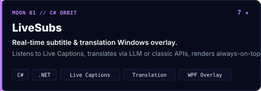
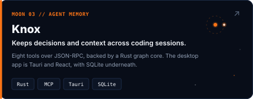
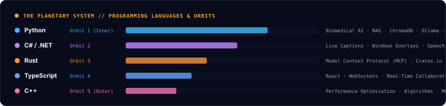

<!-- SOLAR SYSTEM ORBITS HERO -->

 
<i>I am the sun; my languages are the planets and my projects their moons.</i>
  

<!-- THE SUN (ABOUT CARD) -->

---

## 🌕 The Moons — Featured Repositories

<table border="0" width="100%">
  <tr>
    <td width="50%" valign="top">
      
    </td>
    <td width="50%" valign="top">
      
    </td>
  </tr>
  <tr>
    <td width="50%" valign="top">
      
    </td>
    <td width="50%" valign="top">
      
    </td>
  </tr>
</table>

---

## 🪐 The Planets — Planetary System & Tech Stack

<b>Orbital Distance & Evidence Index</b>

 

| Orbit | Celestial Body | Domain | Verified Repositories |
|---|---|---|---|
| **Orbit 1** | **Python** (Inner) | Biomedical AI & Evidence RAG | [`Griffin`](https://github.com/Diva143V/Griffin), [`SyGriffin`](https://github.com/Diva143V/SyGriffin) |
| **Orbit 2** | **C# / .NET** | Windows Subtitle & Overlay Systems | [`LiveSubs`](https://github.com/Diva143V/LiveSubs) |
| **Orbit 3** | **Rust** | High-Assurance MCP Memory Vault | [`Knox`](https://github.com/Diva143V/Knox) |
| **Orbit 4** | **TypeScript** | Real-Time Collaboration & Interfaces | [`chatstream`](https://github.com/Diva143V/chatstream), [`myselfdiva`](https://github.com/Diva143V/myselfdiva) |
| **Orbit 5** | **C++** (Outer) | Algorithmic Optimization & Systems | `HackMe Solver` (1st Place Winner) |

---

## 📡 Solar Log — Revolutions & Telemetry

### Verified Experience & Orbit Logs
- **AI Developer Intern** — *Aegion Dynamic Solutions* `[Jul 2026 — Present]`
  - Building AI-powered automation, intelligent workflows, and production LLM integrations.
- **Front-End Developer Intern** — *Aegion Dynamic Solutions* `[Aug — Oct 2025]`
  - Rebuilt React interfaces, trimmed redundant rendering cycles, and tightened API handoffs.
- **Community Moderator** — *Mecha Break (Amazing Seasun Games)* `[Mar 2024 — Jul 2025]`
  - Managed an active gaming community of 185,000+ members, distilling player feedback into developer reports.

### Podium & Credentials
- 🥇 **1st Place Winner** — *HackMe Problem Statement Solver (2024)* (Custom C++ data structures & search tuning)
- 📜 **Software Engineering Simulation** — *JPMorgan Chase & Co.* `[Jan 2026]`
- 📜 **Google Cloud Compute Fundamentals** — *Google* `[Oct 2025]`
- 📜 **C & C++ Programming Certification** — *HackerRank*

---

## ☀️ Transmission Channels

  

  
  
  
  

 
Solar System · planets are languages, moons are projects, comets are recent activity

