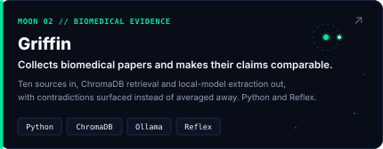
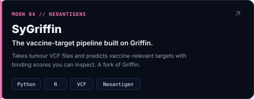
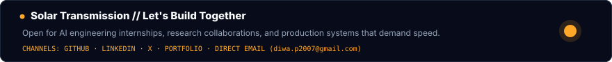

<!-- Generated by scripts/generate_solar.py. Edit scripts/content.py instead. -->

  
   
  <i>Languages are planets. Projects are moons. I'm the sun in the middle.</i>

I'm Diwakar, Diva to most people. I'm studying computer science at Andhra University and working as an AI developer intern at Aegion Dynamic Solutions. I live in Visakhapatnam, on the east coast of India.

Most of what I build starts with something that is already happening: a speaker who won't wait for the translation, a pile of papers that disagree, an agent that needs to remember a decision from six sessions ago. I like the part where a messy live feed turns into something a person can read at a glance.

I started on the front end, rebuilding React screens and learning to measure a render before calling it faster. I still care about that, but these days more of my time goes into Python pipelines, Windows overlays in C#, and Rust servers.

The map is a little theatrical: languages are planets, projects are moons, and I'm the sun in the middle. I kept it because it makes the stack easier to read at a glance.

  

## The moons

Four projects I keep coming back to.

<table border="0" width="100%">
  <tr>
    <td width="50%" valign="top">
      
    </td>
    <td width="50%" valign="top">
      
    </td>
  </tr>
  <tr>
    <td width="50%" valign="top">
      
    </td>
    <td width="50%" valign="top">
      
    </td>
  </tr>
</table>

Smaller things: [Polaris](https://github.com/Diva143V/Kg-Library-API) (a Think-on-Graph knowledge graph library) and [myselfdiva](https://github.com/Diva143V/myselfdiva) (my portfolio).

## The planets

  

| Orbit | Language | Work | Evidence |
|---|---|---|---|
| Orbit 1 / inner | **Python** | Biomedical RAG, local models, data pipelines | Griffin / SyGriffin |
| Orbit 2 | **C# / .NET** | Windows overlays, live captions, WPF | LiveSubs |
| Orbit 3 | **Rust** | MCP server, graph core, Tauri | Knox |
| Orbit 4 | **TypeScript** | React, Vite, interface work | myselfdiva |
| Orbit 5 / outer | **C++** | Algorithms and data structures | HackMe 2024 |

## The solar log

  

- **AI developer intern**, Aegion Dynamic Solutions. Jul 2026 to now. Production LLM integrations, automation, and the unglamorous plumbing that makes them reliable.
- **Front-end developer intern**, Aegion Dynamic Solutions. Aug to Oct 2025. Rebuilt React interfaces, cut unnecessary renders, and tightened the handoff between the UI and the API.
- **Community moderator**, Mecha Break. Mar 2024 to Jul 2025. 185,000 members. My job was turning a firehose of player reports into something the developers could act on.

I took first place at HackMe 2024, solving their problem statement in C++, and completed the JPMorgan Chase software engineering simulation in 2026.

## Transmission

  

[Portfolio](https://myselfdiva.netlify.app/) · [LinkedIn](https://linkedin.com/in/diwakar-venkat-peddada-66aa30229/) · [X](https://x.com/Diva_2007_) · [Email](mailto:diwa.p2007@gmail.com)

If you're working on something where latency actually matters, my inbox is open.
