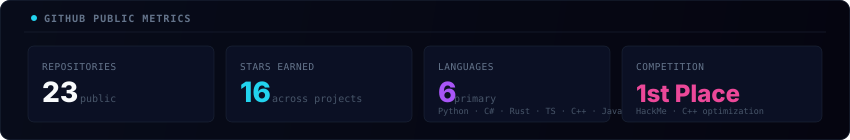
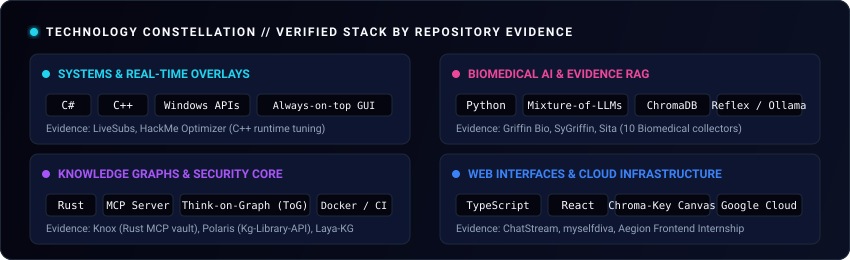
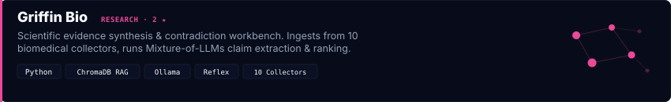
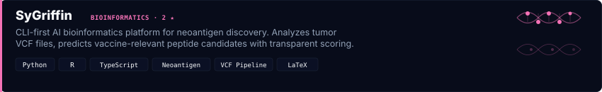
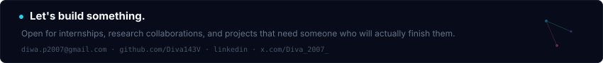

---

## About

I'm **Diwakar Venkat Peddada** — I go by Diva. I study CS at Andhra University and work as an AI developer intern at Aegion Dynamic Solutions.

I like problems where the answer has to arrive while you're still watching: captions that keep pace with a speaker, a pipeline that reads thousands of papers and tells you where they disagree, an overlay that sits on top of your video call and just works.

I started on the front end — rebuilding React interfaces at Aegion, learning to measure something before claiming it got faster. Since then I've been working further down the stack: Windows overlays in C#, embeddings and retrieval for research data, MCP servers in Rust, and a bioinformatics platform that predicts neoantigen candidates from tumor VCF files.

Outside of code, I moderated a 185,000-member community for Mecha Break, which taught me to write for people who haven't read the manual.

---

## Stats

---

## Stack

Everything listed here is backed by repository source code, not résumé padding.

<b>Where each technology is used</b>

 

| Domain | Technologies | Evidence |
|---|---|---|
| **Systems & real-time** | C#, .NET, C++, Windows APIs, Live Captions | [LiveSubs](https://github.com/Diva143V/LiveSubs), HackMe solver |
| **Biomedical AI** | Python, ChromaDB, Ollama, RAG, Mixture-of-LLMs, Reflex | [Griffin](https://github.com/Diva143V/Griffin), [SyGriffin](https://github.com/Diva143V/SyGriffin) |
| **Knowledge graphs & security** | Rust, MCP, Think-on-Graph, Docker | [Knox](https://github.com/Diva143V/Knox), [Kg-Library-API](https://github.com/Diva143V/Kg-Library-API), [Laya-KG](https://github.com/Diva143V/Laya-KG) |
| **Web & cloud** | TypeScript, React, Node.js, Canvas, Google Cloud, GitHub CI | [chatstream](https://github.com/Diva143V/chatstream), [myselfdiva](https://github.com/Diva143V/myselfdiva) |

---

## Projects

### LiveSubs

Real-time subtitle and translation overlay for Windows. Hooks into Live Captions, translates through LLM or traditional APIs, renders always-on-top subtitles over any app — calls, streams, lectures. Ships with [downloadable releases](https://github.com/Diva143V/LiveSubs/releases).

---

### Griffin Bio

Scientific evidence synthesis workbench. Collects from 10 biomedical sources (PubMed, Europe PMC, ChEMBL, UniProt, OpenAlex, and more), deduplicates, embeds in ChromaDB, then runs a Mixture-of-LLMs pipeline to extract claims, rank evidence, and flag contradictions. Live dashboard via Reflex.

---

### Knox

Rust-based Model Context Protocol (MCP) memory server for AI agents. Provides session isolation, cryptographic boundaries, and secure persistence. Published to Crates.io with automated CI/CD releases.

---

### SyGriffin

CLI-first AI bioinformatics platform for neoantigen discovery. Takes tumor VCF files, predicts vaccine-relevant peptide candidates, ranks them with transparent scoring, and generates reproducible LaTeX research reports. For research use only — not a diagnostic tool.

---

## Experience

**AI Developer Intern** — Aegion Dynamic Solutions `Jul 2026 — Present`
Building AI-powered features and LLM integrations that ship into production.

**Front-End Developer Intern** — Aegion Dynamic Solutions `Aug — Oct 2025`
Rebuilt React interfaces, cut unnecessary re-renders, tightened API integration.

**Community Moderator** — Mecha Break / Amazing Seasun Games `Mar 2024 — Jul 2025`
Managed 185,000+ members. Compiled player feedback into actionable developer reports.

### Credentials
- 🥇 **1st Place** — HackMe Problem Statement Solver (2024)
- JPMorgan Chase & Co. Software Engineering Simulation
- Google Cloud Compute Fundamentals
- HackerRank C & C++ Certification

---

## Connect

  
<a href="https://myselfdiva.netlify.app/">Portfolio</a> · <a href="https://linkedin.com/in/diwakar-venkat-peddada-66aa30229/">LinkedIn</a> · <a href="https://x.com/Diva_2007_">X</a> · <a href="mailto:diwa.p2007@gmail.com">diwa.p2007@gmail.com</a>

