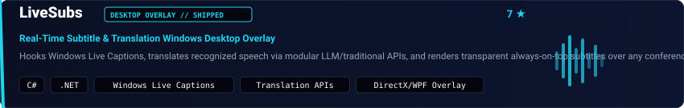
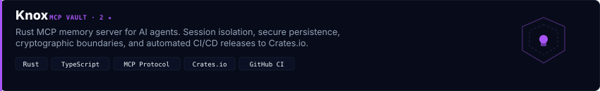
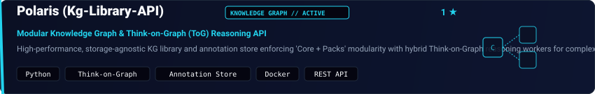
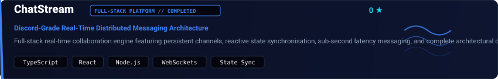

<!-- HERO BANNER -->

 

<!-- QUICK NAVIGATION BADGES -->

  
  
  
  
  

---

## 🔭 About the Builder

I am **Diwakar Venkat Peddada** (*Diva*), a software engineer and AI developer currently studying Computer Science at **Andhra University** ('28) and interning at **Aegion Dynamic Solutions**.

> *"I like problems where the answer has to arrive while you are still watching — captions that keep pace with a live speaker, a pipeline that digests thousands of biomedical papers and isolates exactly where they disagree, or interfaces that stay snappy under load."*

My work spans from low-level systems and desktop overlays to large-scale biomedical research pipelines and knowledge graphs:

- **Real-Time Desktop & Systems Engineering**: Architected **LiveSubs**, an always-on-top Windows subtitle and translation overlay listening to Windows Live Captions and translating speech in real time with custom LLM/API pipelines.
- **Biomedical AI & Evidence Synthesis**: Developed **Griffin Bio**, a multi-source research workbench that ingests from 10 modular collectors (PubMed, Europe PMC, ChEMBL, UniProt, OpenAlex), embeds scientific literature in ChromaDB, and runs a Mixture-of-LLMs pipeline to detect claim contradictions and synthesize consensus.
- **Knowledge Graphs & Autonomous Agent Infrastructure**: Engineered **Knox** (a high-assurance Rust MCP memory vault) and **Polaris** (a modular Think-on-Graph API and hybrid reasoning worker).
- **High-Concurrency Community Management**: Moderated a **185,000+ member community** for *Mecha Break* (Amazing Seasun Games), distilling real-time player telemetry and feedback into actionable developer reports.

---

## 📊 Cosmic Statistics

  

---

## 🪐 Technology Constellation

Verified stack backed by repository source code inspection and production experience:

  

<b>Detailed Technical Breakdown</b>

 

| Domain | Verified Technologies | Selected Repositories |
|---|---|---|
| **Systems & Overlays** | C#, .NET, C++, Windows Win32 APIs, Live Captions, Memory Optimization | [`LiveSubs`](https://github.com/Diva143V/LiveSubs), `HackMe Solver` |
| **Biomedical & AI Engineering** | Python, Mixture of LLMs, ChromaDB, Ollama, RAG Pipelines, Reflex | [`Griffin`](https://github.com/Diva143V/Griffin), [`SyGriffin`](https://github.com/Diva143V/SyGriffin), [`vinu`](https://github.com/Diva143V/vinu) |
| **Knowledge Graphs & Core** | Rust, Model Context Protocol (MCP), Think-on-Graph (ToG), Docker | [`Knox`](https://github.com/Diva143V/Knox), [`Kg-Library-API`](https://github.com/Diva143V/Kg-Library-API), [`Laya-KG`](https://github.com/Diva143V/Laya-KG) |
| **Web & Interactive Interfaces** | TypeScript, React, HTML5/CSS3, Canvas Chroma-Key, WebSockets | [`chatstream`](https://github.com/Diva143V/chatstream), [`myselfdiva`](https://github.com/Diva143V/myselfdiva) |
| **Cloud & DevOps** | Google Cloud Platform (Compute), Git, GitHub Actions CI/CD, Linux | [JPMorgan Chase Simulation](https://github.com/Diva143V/forage-midas), Google Cloud Compute |

---

## 🚀 Featured Flagship Projects

### 01. LiveSubs — Real-Time Subtitle & Translation Windows Overlay

  

- **Core Architecture**: Native Windows desktop application listening directly to Windows Live Captions audio stream.
- **Features**: Translates captured text via modular LLM and classical translation APIs, rendering clean, customizable, always-on-top subtitles over conference calls, video streams, and presentations.
- **Repository**: [`github.com/Diva143V/LiveSubs`](https://github.com/Diva143V/LiveSubs) · **Downloads**: [Releases Available](https://github.com/Diva143V/LiveSubs/releases)

---

### 02. Griffin Bio — Scientific Evidence Synthesis & Contradiction Workbench

  

- **Core Architecture**: Life-sciences research companion turning unstructured biological queries into reproducible research workflows.
- **Pipeline**: Ingests from 10 modular collectors (PubMed, Europe PMC, Semantic Scholar, OpenAlex, ClinicalTrials, bioRxiv, ChEMBL, UniProt, PubChem, dbSNP), embeds abstracts in ChromaDB, and executes Mixture-of-LLMs claim extraction to rank evidence and flag scientific contradictions.
- **Repository**: [`github.com/Diva143V/Griffin`](https://github.com/Diva143V/Griffin)

---

### 03. Knox — High-Assurance Rust MCP Memory & Security Vault

  

- **Core Architecture**: Cryptographically hardened Model Context Protocol (MCP) server written in Rust for context isolation and agent memory management.
- **Features**: Verified session boundaries, secure persistence, automated multi-platform CI/CD and release workflow for Crates.io distribution.
- **Repository**: [`github.com/Diva143V/Knox`](https://github.com/Diva143V/Knox)

---

### 04. Polaris (Kg-Library-API) — Hybrid Think-on-Graph (ToG) Worker

  

- **Core Architecture**: Modular, high-performance, storage-agnostic Knowledge Graph API and annotation store.
- **Features**: Enforces strict "Core + Packs" architecture, keeping base facts separated from domain extensions while powering hybrid Think-on-Graph reasoning workers.
- **Repository**: [`github.com/Diva143V/Kg-Library-API`](https://github.com/Diva143V/Kg-Library-API)

---

### 05. ChatStream — Discord-Grade Real-Time Collaboration Engine

  

- **Core Architecture**: Full-stack real-time collaboration application built with TypeScript, React, and WebSockets.
- **Features**: Multi-channel workspaces, instant state synchronisation, resilient message queuing, and comprehensive architectural documentation.
- **Repository**: [`github.com/Diva143V/chatstream`](https://github.com/Diva143V/chatstream)

---

## 🏆 Experience & Podium

### Professional Roles
- **AI Developer Intern** — *Aegion Dynamic Solutions* `[Jul 2026 — Present]`
  - Building AI-powered applications, intelligent automation, and production LLM integrations.
- **Front-End Developer Intern** — *Aegion Dynamic Solutions* `[Aug — Oct 2025]`
  - Reworked React interfaces, eliminated redundant re-renders, and tightened API handoff performance.
- **Community Moderator** — *Mecha Break (Amazing Seasun Games)* `[Mar 2024 — Jul 2025]`
  - Managed an active gaming community of 185,000+ members, compiling player issue digests for game developers.

### Verified Credentials & Competitions
- 🥇 **1st Place Winner** — *HackMe Problem Statement Solver (2024)* (Custom C++ data structures & search optimization)
- 📜 **Software Engineering Simulation** — *JPMorgan Chase & Co.* `[Jan 2026]`
- 📜 **Google Cloud Compute Fundamentals** — *Google* `[Oct 2025]`
- 📜 **C & C++ Programming Certification** — *HackerRank*

---

## 📡 Cosmic Connect

  
    
  

    
    
    
    
  

   
  Architected with NEBULA / 01 Design System · Verified Audit by Diva143V

